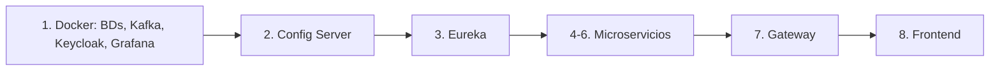
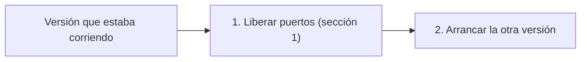

# Guía: arrancar la app

*Guía de Proyecto Sello - Lamb completo (Admisión + Trayectoria): comandos en orden y todos los links - 2026*

Esta guía levanta **todo el proyecto Lamb** desde cero: bases de datos y demás contenedores en Docker,
Config Server, Eureka, los microservicios, el Gateway y el frontend. Al final están **todos los links**
(Eureka, Kafka UI, Keycloak, Grafana, Swagger...).



El orden importa: cada paso necesita que el anterior ya esté arriba.

## 0. Antes de empezar

1. Abre **Docker Desktop** y espera a que diga *Engine running*.
2. Abre en VS Code la carpeta del proyecto **`Lamb-Modulo02-Admision-Trayectoria`** (la **raíz**).
3. Si es tu primera vez, revisa tu computadora con la [S1, sección 1.5](../sesiones/S01_Construccion_Servicio_Base.md#15-verifica-tu-computadora-antes-de-todo)
   (Java 21, Docker, Node.js).

**Cómo abrir cada terminal:** en VS Code, *Terminal → New Terminal* (o el **+** del panel de terminales). Se abre
en la raíz del proyecto. Cada servicio (pasos 2 a 8) va en **su propia terminal** y se queda corriendo ahí:
**no la cierres**.

!!! note "PowerShell o CMD"
    Los comandos están escritos para **PowerShell** (la terminal por defecto de VS Code en Windows).
    Los de `docker` y `cd` funcionan igual en **CMD**. La única diferencia: en CMD se escribe
    `mvnw.cmd spring-boot:run` (sin el `.\` del inicio).

## 1. Liberar los puertos

Si algo de Lamb quedó corriendo de antes (otra terminal, otra copia del proyecto), los servicios no arrancan
(`Port ... was already in use`). Esto lo apaga todo.

**Dónde:** cualquier PowerShell.  
**Pega:**

```powershell
$puertos = @(4200, 8095, 8096, 8097, 13000, 13100, 15436, 18080, 18090, 18092, 18180, 18761, 18888, 19000, 19090) + (8081..8089) + (15451..15461)
foreach ($p in $puertos) {
    $c = Get-NetTCPConnection -LocalPort $p -State Listen -ErrorAction SilentlyContinue | Select-Object -First 1
    if (-not $c) { continue }
    $proc = Get-Process -Id $c.OwningProcess -ErrorAction SilentlyContinue
    if ($proc.ProcessName -match '^(com\.docker\.backend|wslrelay|vpnkit|docker)') {
        docker ps -q --filter "publish=$p" | ForEach-Object { docker stop $_ | Out-Null }
        "[LIBERADO] $p  (contenedor de Docker)"
    } else {
        Stop-Process -Id $c.OwningProcess -Force
        "[LIBERADO] $p  ($($proc.ProcessName))"
    }
}
"Listo: puertos libres."
```

Si no sale ninguna línea `[LIBERADO]`, ya estaba todo libre.

Si más adelante te sale un error al arrancar, búscalo en la [sección 14: errores comunes](#14-errores-comunes-al-arrancar).

## 2. Solo la primera vez: instalar el frontend

**Dónde:** terminal en la raíz del proyecto.  
**Pega** (tarda unos minutos, descarga librerías):

```powershell
cd clients\lamb-frontend
npm install
cd ..\..
```

La primera vez que arranques cada servicio Java también tarda más: `mvnw.cmd` descarga sus librerías.

## 3. Paso 1: Docker (bases de datos, Kafka, Keycloak y Grafana)

**Dónde:** terminal en la raíz del proyecto. Docker Desktop debe estar abierto.  
**Pega todo el bloque de una vez:**

```powershell
docker compose -f kafka/compose-dev.yml up -d
docker compose -f keycloak/compose-dev.yml up -d
docker compose -f services/lamb-admision-ms/compose-dev.yml up -d
docker compose -f services/lamb-trayectoria-ms/compose-dev.yml up -d
docker compose -f obs/compose-dev.yml up -d
```

| Línea | Qué levanta |
|---|---|
| `kafka/compose-dev.yml` | Kafka (`18092`) y Kafka UI (`18090`) |
| `keycloak/compose-dev.yml` | Keycloak (`18180`) y su base de datos (`15436`) |
| `services/lamb-admision-ms/compose-dev.yml` | Base de datos de Admisión (`15454`) |
| `services/lamb-trayectoria-ms/compose-dev.yml` | Base de datos de Trayectoria (`15459`) |
| `obs/compose-dev.yml` | Prometheus (`19090`), Loki (`13100`), Promtail y Grafana (`13000`) |

**Comprueba** que todo esté arriba:

```powershell
docker ps --format "table {{.Names}}\t{{.Status}}"
```

Deben salir, con estado *Up*:

```text
lamb-kafka-dev
lamb-kafka-ui-dev
lamb-keycloak-db
lamb-keycloak
lamb-postgres-admision-dev
lamb-postgres-trayectoria-dev
lamb-prometheus-dev
lamb-loki-dev
lamb-promtail-dev
lamb-grafana-dev
```

!!! note "Keycloak tarda ~1 minuto"
    Aunque diga *Up*, Keycloak sigue arrancando por dentro. Está listo cuando abre http://localhost:18180/realms/lamb
    (muestra un JSON). Hasta entonces, el login del frontend no funciona.

!!! note "Si tienes poca RAM (8 GB)"
    La línea de `obs` (Grafana) es opcional: sin ella la app funciona, solo no ves logs ni métricas.

## 4. Paso 2: Config Server (terminal 1)

Todos los servicios piden su configuración aquí, por eso va **primero**.

**Dónde:** terminal **nueva** en la raíz del proyecto.  
**Pega:**

```powershell
cd infra\lamb-config
.\mvnw.cmd spring-boot:run
```

**Espera** a que salga `Started LambConfigApplication`. **Comprueba:** http://localhost:18888/lamb-admision-ms/dev
→ un JSON con la configuración de Admisión.

## 5. Paso 3: Eureka (terminal 2)

Aquí se registran los servicios para que el Gateway los encuentre.

**Dónde:** terminal **nueva** en la raíz del proyecto.  
**Pega:**

```powershell
cd infra\lamb-eureka
.\mvnw.cmd spring-boot:run
```

**Espera** `Started ...`. **Comprueba:** http://localhost:18761 → abre el panel de Eureka (aún sin servicios).

## 6. Paso 4: Admisión (terminal 3)

**Dónde:** terminal **nueva** en la raíz del proyecto.  
**Pega:**

```powershell
cd services\lamb-admision-ms
.\mvnw.cmd spring-boot:run
```

**Espera** `Started ...`. **Comprueba:** http://localhost:8084/actuator/health → `"status":"UP"`.

## 7. Paso 5: Trayectoria (terminal 4)

**Dónde:** terminal **nueva** en la raíz del proyecto.  
**Pega:**

```powershell
cd services\lamb-trayectoria-ms
.\mvnw.cmd spring-boot:run
```

**Espera** `Started ...`. **Comprueba:** http://localhost:8089/actuator/health → `"status":"UP"`.

## 8. Paso 6 (opcional): tu servicio nuevo (terminal 5)

Solo si ya agregaste tu servicio con la guía principal (ejemplo `lamb-evaluacionn-ms`; cambia el nombre por el tuyo).
Primero su base de datos (en cualquier terminal) y después el servicio en una terminal **nueva**:

```powershell
docker compose -f services/lamb-evaluacionn-ms/compose-dev.yml up -d
```

```powershell
cd services\lamb-evaluacionn-ms
.\mvnw.cmd spring-boot:run
```

**Comprueba:** http://localhost:8095/actuator/health → `"status":"UP"`.

## 9. Paso 7: Gateway (terminal 6)

Va **al final** de los servicios Java: necesita que ya estén registrados en Eureka.

**Antes:** abre http://localhost:18761 y espera (~30 s) a que salgan **`LAMB-ADMISION-MS`** y **`LAMB-TRAYECTORIA-MS`**
(y el tuyo, si lo arrancaste).

**Dónde:** terminal **nueva** en la raíz del proyecto.  
**Pega:**

```powershell
cd infra\lamb-gateway
.\mvnw.cmd spring-boot:run
```

**Espera** `Started ...`. **Comprueba:** http://localhost:18080/actuator/health → `"status":"UP"`.

## 10. Paso 8: Frontend (terminal 7)

**Dónde:** terminal **nueva** en la raíz del proyecto.  
**Pega:**

```powershell
cd clients\lamb-frontend
npm start
```

**Espera** `Local: http://localhost:4200/`. **Abre:** http://localhost:4200

Para el panel de administración: http://localhost:4200/admin → te pide login → `admin` / `admin123`.

## 11. Comprobar todo de una vez

**Dónde:** cualquier PowerShell.  
**Pega:**

```powershell
$urls = [ordered]@{
    "Config Server" = "http://localhost:18888/actuator/health"
    "Eureka"        = "http://localhost:18761/actuator/health"
    "Admision"      = "http://localhost:8084/actuator/health"
    "Trayectoria"   = "http://localhost:8089/actuator/health"
    "Gateway"       = "http://localhost:18080/actuator/health"
    "Keycloak"      = "http://localhost:18180/realms/lamb"
    "Kafka UI"      = "http://localhost:18090"
    "Grafana"       = "http://localhost:13000/api/health"
    "Frontend"      = "http://localhost:4200"
}
foreach ($n in $urls.Keys) {
    try { Invoke-WebRequest $urls[$n] -UseBasicParsing -TimeoutSec 5 | Out-Null; "[OK]    $n" }
    catch { "[FALLA] $n  -> $($urls[$n])" }
}
```

Todo debe decir `[OK]`. Si algo dice `[FALLA]`, revisa la terminal de ese componente o la sección 14.

## 12. Links de todo

### 12.1 Frontend

| Página | Link | Login |
|---|---|---|
| Inicio | http://localhost:4200 | — |
| Postular (wizard de postulación) | http://localhost:4200/postular | — |
| Seguimiento de la postulación | http://localhost:4200/seguimiento | — |
| Pagar | http://localhost:4200/pagar | — |
| Panel de administración | http://localhost:4200/admin | `admin` / `admin123` |
| Admisión (dashboard) | http://localhost:4200/admin/admision | `admin` / `admin123` |
| Trayectoria (dashboard) | http://localhost:4200/admin/trayectoria | `admin` / `admin123` |
| Bandeja de admisión | http://localhost:4200/admin/prospectos | `admin` / `admin123` |
| Derecho de admisión | http://localhost:4200/admin/derecho-admision | `admin` / `admin123` |
| Buscador RENIEC | http://localhost:4200/admin/reniec | `admin` / `admin123` |
| Plan académico | http://localhost:4200/admin/trayectoria/plan | `admin` / `admin123` |
| Tu servicio (si lo agregaste) | http://localhost:4200/evaluacionn | `admin` / `admin123` |

### 12.2 Infraestructura

| Componente | Link | Para qué |
|---|---|---|
| Config Server | http://localhost:18888/lamb-admision-ms/dev | Configuración de un servicio (cambia el nombre en el link) |
| Config Server (Gateway) | http://localhost:18888/lamb-gateway/dev | Rutas del Gateway |
| Eureka | http://localhost:18761 | Servicios registrados e instancias |
| Gateway | http://localhost:18080 | Punto único de acceso a la API |
| Gateway - salud | http://localhost:18080/actuator/health | `UP` si el Gateway está bien |

### 12.3 Seguridad (Keycloak)

| Componente | Link | Usuario / contraseña |
|---|---|---|
| Consola de Keycloak | http://localhost:18180/admin/master/console/#/lamb | `admin` / `admin123` |
| Realm `lamb` | http://localhost:18180/realms/lamb | — |
| Configuración OpenID | http://localhost:18180/realms/lamb/.well-known/openid-configuration | — |

| Usuario de prueba | Contraseña | Rol |
|---|---|---|
| `admin` | `admin123` | `ADMIN` |
| `docente1` | `docente123` | `DOCENTE` |
| `estudiante1` | `estudiante123` | `ESTUDIANTE` |

### 12.4 Mensajería (Kafka)

| Componente | Link | Para qué |
|---|---|---|
| Kafka UI | http://localhost:18090 | Topics, mensajes y consumidores |
| Kafka UI - topics | http://localhost:18090/ui/clusters/lamb-dev/all-topics | `admision-eventos` y los demás topics |
| Kafka (broker) | `localhost:18092` | No se abre en el navegador: lo usan los servicios |

### 12.5 Observabilidad

| Componente | Link | Usuario / contraseña | Para qué |
|---|---|---|---|
| Grafana | http://localhost:13000 | `admin` / `admin` | Paneles, logs y métricas |
| Grafana - Explore | http://localhost:13000/explore | `admin` / `admin` | Consultas a Loki (logs) y Prometheus (métricas) |
| Grafana - dashboard Lamb | http://localhost:13000/d/lamb-infra | `admin` / `admin` | *Lamb - Infraestructura* |
| Prometheus | http://localhost:19090 | — | Métricas |
| Prometheus - targets | http://localhost:19090/targets | — | Qué servicios está leyendo (UP / DOWN) |
| Loki - servicios con logs | http://localhost:13100/loki/api/v1/label/application/values | — | Servicios que ya mandan logs |

### 12.6 Microservicios

| Servicio | Puerto | Swagger | Salud |
|---|---|---|---|
| `lamb-admision-ms` | 8084 | http://localhost:8084/swagger-ui.html | http://localhost:8084/actuator/health |
| `lamb-trayectoria-ms` | 8089 | http://localhost:8089/swagger-ui.html | http://localhost:8089/actuator/health |
| Tu servicio (ej. `lamb-evaluacionn-ms`) | 8095 | http://localhost:8095/swagger-ui.html | http://localhost:8095/actuator/health |

### 12.7 Bases de datos

Para verlas en VS Code con la extensión **Database Client** (pasos en la
[S2, sección 5](../sesiones/S02_Configuracion_Centralizada_Ambientes.md#5-ver-la-base-de-datos-en-vs-code)): Host `127.0.0.1` y estos datos.

| Base de datos | Puerto | Nombre de la BD | Usuario / contraseña |
|---|---|---|---|
| Admisión | `15454` | `lamb_admision_db` | `lamb` / `lamb` |
| Trayectoria | `15459` | `lamb_trayectoria_db` | `lamb` / `lamb` |
| Tu servicio (ejemplo) | `15460` | `lamb_evaluacionn_db` | `lamb` / `lamb` |

### 12.8 Puertos

| Puerto | Componente |
|---|---|
| 4200 | Frontend Angular |
| 8084 | Admisión |
| 8089 | Trayectoria |
| 8095 | Tu servicio (ejemplo) |
| 13000 | Grafana |
| 13100 | Loki |
| 15436 | BD de Keycloak |
| 15454 / 15459 | BD de Admisión / BD de Trayectoria |
| 15460 | BD de tu servicio (ejemplo) |
| 18080 | Gateway |
| 18090 | Kafka UI |
| 18092 | Kafka |
| 18180 | Keycloak |
| 18761 | Eureka |
| 18888 | Config Server |
| 19090 | Prometheus |

## 13. Parar todo

1. En cada terminal de los pasos 2 a 8, pulsa `Ctrl+C` (si pregunta, responde `S` o `Y`).
2. Detén los contenedores (los datos **no** se borran):

```powershell
docker compose -f obs/compose-dev.yml stop
docker compose -f services/lamb-trayectoria-ms/compose-dev.yml stop
docker compose -f services/lamb-admision-ms/compose-dev.yml stop
docker compose -f keycloak/compose-dev.yml stop
docker compose -f kafka/compose-dev.yml stop
```

Si cerraste las terminales sin `Ctrl+C` y algo sigue ocupando los puertos, usa el script de la sección 1.

La próxima vez empiezas desde el **paso 1** (sin la sección 2, que es solo la primera vez).

## 14. Errores comunes al arrancar

Busca aquí el mensaje que te sale (`Ctrl+F` en el navegador). Cada error dice **por qué pasa** y **qué pegar**.
Si no está aquí, búscalo en [Solución de errores](../sesiones/Solucion_Errores.md).

| Te sale... | Ve a |
|---|---|
| `Port ... was already in use` / `Address already in use` | [14.1](#141-port-was-already-in-use-el-puerto-ya-esta-en-uso) |
| `port is already allocated` (al hacer `docker compose up`) | [14.2](#142-port-is-already-allocated-docker) |
| `Port 4200 is already in use` | [14.3](#143-port-4200-is-already-in-use-frontend) |
| `error during connect` / `docker` no responde | [14.4](#144-docker-no-responde) |
| `.\mvnw.cmd : El término no se reconoce...` | [14.5](#145-mvnwcmd-no-se-reconoce) |
| `JAVA_HOME not found` / `release version 21 not supported` | [14.6](#146-java_home-not-found-release-version-21-not-supported) |
| `Could not resolve placeholder` / `Connection refused ... 18888` | [14.7](#147-el-servicio-no-encuentra-su-configuracion) |
| `Connection to localhost:15454 refused` (o 15459, 15460) | [14.8](#148-connection-to-localhost1545x-refused-base-de-datos) |
| Gateway `503` / `Unable to find instance` / el servicio no sale en Eureka | [14.9](#149-gateway-503-o-el-servicio-no-sale-en-eureka) |
| El login no abre / `Keycloak init failed` / `Invalid parameter: redirect_uri` | [14.10](#1410-el-login-de-keycloak-no-funciona) |
| `Connection to node -1 (localhost/127.0.0.1:18092)` | [14.11](#1411-kafka-connection-to-node-1-could-not-be-established) |
| `npm.ps1 no se puede cargar` / `'ng' no se reconoce` | [14.12](#1412-errores-de-npm-al-arrancar-el-frontend) |
| `Unable to rename '...jar'` | [14.13](#1413-unable-to-rename-jar) |
| Grafana no abre | [14.14](#1414-grafana-no-abre) |
| La PC se pone muy lenta o Docker se cae | [14.15](#1415-la-pc-se-pone-lenta-o-docker-se-cae) |

### 14.1 `Port ... was already in use` (el puerto ya está en uso)

**Te sale** (al arrancar un servicio Java):

```text
Web server failed to start. Port 18888 was already in use.
```

**Por qué:** algo ya está usando ese puerto. Casi siempre es **el mismo servicio abierto dos veces** (otra terminal
que no cerraste), un `java` que quedó colgado, o **otra copia del proyecto Lamb** que arrancaste antes.

**Solución A (recomendada): liberar todos los puertos de Lamb de una vez.** Es el mismo comando de la
[S1, sección 0](../sesiones/S01_Construccion_Servicio_Base.md#0-liberar-todos-los-puertos-antes-de-empezar).
Apaga los `java` y `node` que ocupan los puertos, y detiene los contenedores de Docker **sin** cerrar Docker Desktop.

**Dónde:** cualquier PowerShell (no importa la carpeta).  
**Pega:**

```powershell
$puertos = @(4200, 8095, 8096, 8097, 13000, 13100, 15436, 18080, 18090, 18092, 18180, 18761, 18888, 19000, 19090) + (8081..8089) + (15451..15461)
foreach ($p in $puertos) {
    $c = Get-NetTCPConnection -LocalPort $p -State Listen -ErrorAction SilentlyContinue | Select-Object -First 1
    if (-not $c) { continue }
    $proc = Get-Process -Id $c.OwningProcess -ErrorAction SilentlyContinue
    if ($proc.ProcessName -match '^(com\.docker\.backend|wslrelay|vpnkit|docker)') {
        docker ps -q --filter "publish=$p" | ForEach-Object { docker stop $_ | Out-Null }
        "[LIBERADO] $p  (contenedor de Docker)"
    } else {
        Stop-Process -Id $c.OwningProcess -Force
        "[LIBERADO] $p  ($($proc.ProcessName))"
    }
}
"Listo: puertos libres."
```

Por cada puerto ocupado sale una línea como `[LIBERADO] 18888  (java)`. Después **vuelve a empezar desde el paso 1**
(los contenedores de Docker se detuvieron y hay que levantarlos otra vez).

!!! note "Si tu servicio usa otro puerto"
    Agrégalo a la primera línea, dentro de `@( ... )` (ej. `8097` y `15461`).

**Solución B: liberar solo un puerto** (ej. el `18888`):

```powershell
Get-NetTCPConnection -LocalPort 18888 -State Listen | Select-Object OwningProcess   # sale un número, ej. 12345
Get-Process -Id 12345                                                              # mira qué programa es
Stop-Process -Id 12345 -Force                                                      # ciérralo
```

Cambia `18888` por el puerto del error y `12345` por el número que te salió.

**Para saber si un puerto quedó libre** (si **no imprime nada**, está libre):

```powershell
Get-NetTCPConnection -LocalPort 18888 -State Listen -ErrorAction SilentlyContinue
```

!!! note "No cambies los puertos de Lamb"
    `18888`, `18761`, `18080`, `18092`, `18180`, `4200`... los usan todos los servicios. Si cambias uno, se rompe lo demás.
    Siempre **libera** el puerto; no lo cambies.

### 14.2 `port is already allocated` (Docker)

**Te sale** (al hacer `docker compose ... up -d`):

```text
Error response from daemon: ... Bind for 0.0.0.0:15454 failed: port is already allocated
```

**Por qué:** otro contenedor ya usa ese puerto, casi siempre uno de **otra copia del proyecto** (o de Pagatu).

**Solución:** el script de la [14.1](#141-port-was-already-in-use-el-puerto-ya-esta-en-uso) también detiene esos
contenedores. O hazlo a mano:

```powershell
docker ps --format "table {{.Names}}\t{{.Ports}}"     # busca el que tiene el puerto del error
docker stop NOMBRE-DEL-CONTENEDOR                       # cambia por el nombre que salió
```

Luego vuelve a pegar el bloque del paso 1.

### 14.3 `Port 4200 is already in use` (frontend)

**Te sale:** `Port 4200 is already in use. Would you like to use a different port?`

**Solución:** responde **No** (`n`) y cierra la otra terminal donde ya corre `npm start`, o usa el script de la
[14.1](#141-port-was-already-in-use-el-puerto-ya-esta-en-uso).

!!! note "No uses otro puerto para el frontend"
    Keycloak solo acepta `http://localhost:4200`. En otro puerto el login falla con `Invalid parameter: redirect_uri`.

### 14.4 Docker no responde

**Te sale:** `error during connect: ... dockerDesktopLinuxEngine` o `Cannot connect to the Docker daemon`.

**Solución:** Docker Desktop está cerrado o todavía arrancando. Ábrelo, espera a que diga **Engine running** y vuelve
a pegar el bloque del paso 1.

### 14.5 `mvnw.cmd` no se reconoce

**Te sale:** `.\mvnw.cmd : El término '.\mvnw.cmd' no se reconoce como nombre de un cmdlet...`

**Por qué:** no estás en la carpeta del servicio (te faltó el `cd`), o estás en **CMD**.

**Solución:**

- Mira la ruta que sale antes del cursor: debe terminar en la carpeta del servicio (ej. `...\infra\lamb-config>`).
  Si no, abre una terminal nueva en la raíz y pega el bloque completo, con su `cd`.
- En **CMD** se escribe sin `.\`: `mvnw.cmd spring-boot:run`.

### 14.6 `JAVA_HOME not found` / `release version 21 not supported`

**Por qué:** no tienes Java 21 o Windows está usando otro Java.

**Solución:**

```powershell
java -version        # debe decir 21
```

Si dice otro número (o nada), instala el JDK 21 (Temurin) y configura `JAVA_HOME`, como en la
[S1, sección 1.5](../sesiones/S01_Construccion_Servicio_Base.md#15-verifica-tu-computadora-antes-de-todo).
**Cierra y vuelve a abrir** las terminales (y VS Code).

### 14.7 El servicio no encuentra su configuración

**Te sale:** `Could not resolve placeholder '...'` o `Could not locate PropertySource ... I/O error on GET request for "http://localhost:18888/..."`.

**Por qué:** arrancaste el servicio **antes** que el Config Server (o el Config Server se cayó).

**Solución:**

1. Abre http://localhost:18888/lamb-admision-ms/dev. Si no carga, arranca el Config Server (paso 2) y espera `Started`.
2. Detén el servicio que falló (`Ctrl+C`) y vuelve a arrancarlo.

### 14.8 `Connection to localhost:1545x refused` (base de datos)

**Por qué:** la base de datos de ese servicio no está levantada.

| Puerto del error | Base de datos | Comando |
|---|---|---|
| `15454` | Admisión | `docker compose -f services/lamb-admision-ms/compose-dev.yml up -d` |
| `15459` | Trayectoria | `docker compose -f services/lamb-trayectoria-ms/compose-dev.yml up -d` |
| `15460` | Tu servicio (ejemplo) | `docker compose -f services/lamb-evaluacionn-ms/compose-dev.yml up -d` |

Comprueba con `docker ps` que salga *Up* y vuelve a arrancar el servicio.

### 14.9 Gateway `503` o el servicio no sale en Eureka

**Te sale:** `503 Service Unavailable` o `Unable to find instance for lamb-admision-ms`.

**Por qué:** el Gateway todavía no encuentra el servicio en Eureka.

**Solución:**

1. Abre http://localhost:18761 y espera **30 segundos**: el servicio tarda en aparecer.
2. Si no aparece nunca, mira la terminal del servicio: si dice `Cannot execute request on any known server`,
   Eureka está apagado → arráncalo (paso 3) y reinicia el servicio.
3. Si el servicio sale en Eureka pero el Gateway sigue en `503`, reinicia el Gateway (`Ctrl+C` y otra vez `.\mvnw.cmd spring-boot:run`).

### 14.10 El login de Keycloak no funciona

| Te sale | Solución |
|---|---|
| La página de login no carga / `Keycloak init failed` | Keycloak está apagado o todavía arrancando (~1 min). Pega `docker compose -f keycloak/compose-dev.yml up -d`, espera a que abra http://localhost:18180/realms/lamb y recarga el frontend |
| `Invalid parameter: redirect_uri` | Abre el frontend en `http://localhost:4200` (no `127.0.0.1` ni otro puerto) |
| `Invalid username or password` | Usa los usuarios de la [sección 12.3](#123-seguridad-keycloak): `admin` / `admin123` |
| "No tienes permiso para esta acción." | El usuario no tiene el rol. Entra con `admin` (cierra sesión y vuelve a entrar) |

### 14.11 Kafka: `Connection to node -1 ... could not be established`

**Por qué:** Kafka está apagado. El servicio sigue funcionando, pero no puede enviar ni recibir eventos.

**Solución:**

```powershell
docker compose -f kafka/compose-dev.yml up -d
```

Espera unos segundos: el servicio se reconecta solo.

### 14.12 Errores de npm al arrancar el frontend

| Te sale | Solución |
|---|---|
| `npm.ps1 no se puede cargar ... la ejecución de scripts está deshabilitada` | Pega una sola vez en PowerShell: `Set-ExecutionPolicy -Scope CurrentUser RemoteSigned` y abre una terminal nueva |
| `'ng' no se reconoce` / `Cannot find module` | Falta instalar: haz la [sección 2](#2-solo-la-primera-vez-instalar-el-frontend) (`npm install`) |
| Pantalla en blanco | Mira la terminal de `npm start`: el error de compilación sale ahí en rojo |

### 14.13 `Unable to rename '...jar'`

**Por qué:** el servicio sigue corriendo mientras lo vuelves a compilar.

**Solución:** detenlo con `Ctrl+C` (o con el script de la [14.1](#141-port-was-already-in-use-el-puerto-ya-esta-en-uso)) y vuelve a compilar.

### 14.14 Grafana no abre

**Solución:** usuario `admin`, contraseña `admin`. Si http://localhost:13000 no carga:

```powershell
docker compose -f obs/compose-dev.yml up -d
```

### 14.15 La PC se pone lenta o Docker se cae

**Por qué:** Lamb completo usa mucha memoria (Keycloak, Kafka, Grafana y varios Java).

**Solución:** levanta solo lo necesario. Grafana es lo primero que puedes apagar:

```powershell
docker compose -f obs/compose-dev.yml stop
```

Cierra también las terminales de los servicios que no estés usando (ej. tu servicio nuevo, si solo pruebas Admisión).

### 14.16 Si nada funciona

1. Pulsa `Ctrl+C` en todas las terminales y ciérralas.
2. Pega el script de la [14.1](#141-port-was-already-in-use-el-puerto-ya-esta-en-uso) para liberar todos los puertos.
3. Empieza de nuevo desde el **paso 1**, esperando el `Started` de cada uno antes de pasar al siguiente.
4. Pega el script de la [sección 11](#11-comprobar-todo-de-una-vez): el **primero** que diga `[FALLA]` es donde está el problema.
5. Busca el mensaje de esa terminal en esta sección o en [Solución de errores](../sesiones/Solucion_Errores.md).

## 15. Cambiar el nombre de un servicio

Si creaste un servicio con el nombre equivocado (ej. `lamb-hola-ms` y querías `lamb-adios-ms`), el script
**`renombrar-servicio.ps1`** lo cambia en **todo** el proyecto de una vez: carpetas, paquete Java, clases,
`config-repo`, rutas del Gateway, BD, topic de Kafka y frontend. Respeta mayúsculas
(`hola → adios`, `Hola → Adios`, `HOLA → ADIOS`).

**Antes de empezar:**

1. Para todo (sección 13) o libera los puertos (sección 1): el servicio no debe estar corriendo.
2. Copia `renombrar-servicio.ps1` a la carpeta **`scripts\`** del proyecto.
3. Abre una terminal en la **raíz** del proyecto (la carpeta que tiene `services\`, `infra\`, `scripts\`...).

**Cómo abrir la terminal en la raíz** (elige una):

- **VS Code:** abre la carpeta del proyecto y luego *Terminal → New Terminal*. Ya se abre en la raíz.
- **PowerShell suelto:** abre PowerShell (menú Inicio → escribe `powershell`), escribe `cd`, un espacio y
  la ruta de tu proyecto **entre comillas**. Para copiar la ruta: en el Explorador de archivos, entra a la
  carpeta del proyecto, haz clic en la barra de direcciones y copia (`Ctrl+C`).

```powershell
cd "C:\Users\TU_USUARIO\Documents\Lamb-Modulo02-Admision-Trayectoria"
dir scripts\renombrar-servicio.ps1      # comprueba que estás en el lugar correcto
```

Si `dir` muestra el archivo, estás bien ubicado: pega ahí el comando de la 15.1 o la 15.2.
Si dice `No se encuentra la ruta`, no estás en la raíz o no copiaste el script a `scripts\`.

!!! note "Por qué las comillas"
    Si la ruta tiene espacios (ej. `lamb uopeu 2.0`), sin comillas `cd` falla. Con comillas siempre funciona.

!!! tip "Prueba primero con `-Simular`"
    Agrega `-Simular` al final de cualquiera de los comandos: muestra **qué cambiaría** sin tocar nada.
    Si te gusta lo que ves, vuelve a correrlo **sin** `-Simular`.

### 15.0 ¿Esta computadora me deja correr scripts?

Hazlo una vez en cada computadora nueva (sobre todo en las de la universidad, que pueden tener
protecciones del área de TI).

**Dónde:** cualquier PowerShell.  
**Pega:**

```powershell
Get-ExecutionPolicy -List
$ExecutionContext.SessionState.LanguageMode
```

Sale algo así:

```text
        Scope ExecutionPolicy
        ----- ---------------
MachinePolicy       Undefined
   UserPolicy       Undefined
      Process       Undefined
  CurrentUser       Undefined
 LocalMachine      Restricted
FullLanguage
```

Fíjate solo en **3 cosas**:

| Si ves... | Significa |
|---|---|
| `MachinePolicy` y `UserPolicy` en **`Undefined`** | ✅ Puedes correr el script con `-ExecutionPolicy Bypass` |
| `MachinePolicy` o `UserPolicy` con otro valor (ej. `AllSigned`, `Restricted`) | ❌ TI bloqueó los scripts |
| La última línea dice **`FullLanguage`** | ✅ El script funciona |
| La última línea dice **`ConstrainedLanguage`** | ❌ El script falla aunque se ejecute |

Las demás líneas (`Process`, `CurrentUser`, `LocalMachine`) **no importan**: `-ExecutionPolicy Bypass` las salta.

!!! warning "Si sale ❌"
    No desactives las protecciones de la universidad (aunque sepas la contraseña). Renombra en tu
    computadora y sube los cambios a git, o haz el cambio a mano.

!!! note "Los comandos que pegas sí funcionan"
    El bloqueo es solo para **archivos** `.ps1`. Los scripts que esta guía te pide **pegar** (liberar
    puertos, comprobar todo) funcionan igual aunque salga ❌.

### 15.1 Servicio sin CRUD

Solo cambia el nombre del servicio. `-De` es el nombre actual y `-A` el nuevo (en minúsculas, sin `lamb-` ni `-ms`).

**Pega** (ejemplo: `lamb-hola-ms` → `lamb-adios-ms`):

```powershell
powershell -ExecutionPolicy Bypass -File scripts\renombrar-servicio.ps1 -Proyecto . -De hola -A adios
```

### 15.2 Servicio con CRUD

Cambia el nombre del servicio **y** el de la entidad del CRUD (clase, controlador, tabla, ruta
`/api/v1/...`, páginas del frontend). `-CrudDe` es la entidad actual y `-CrudA` la nueva.

**Pega** (ejemplo: `lamb-alumno-ms` con CRUD `Alumno` → `lamb-libro-ms` con CRUD `Libro`):

```powershell
powershell -ExecutionPolicy Bypass -File scripts\renombrar-servicio.ps1 -Proyecto . -De alumno -A libro -CrudDe alumno -CrudA libro
```

Si solo quieres cambiar la entidad del CRUD y dejar el nombre del servicio, usa solo `-CrudDe` y `-CrudA`
(sin `-De` ni `-A`).

### 15.3 Después de renombrar

El script te dice los pasos al final. Para un servicio renombrado (ej. a `adios`):

```powershell
docker rm -f lamb-postgres-hola-dev                                  # borra la BD vieja
docker compose -f services/lamb-adios-ms/compose-dev.yml up -d       # crea la BD nueva (empieza vacía)
```

Luego arranca de nuevo **Config Server, Eureka, tu servicio y el Gateway** (pasos 2 a 7) y el frontend
(paso 8): cambiaron sus rutas y su configuración. Usa `.\mvnw.cmd clean spring-boot:run` en el servicio
renombrado para que no quede nada compilado con el nombre viejo.

!!! warning "Si dice `El nombre nuevo ya aparece en N archivos`"
    El nombre que elegiste ya se usa en Lamb (ej. `estudiante` es un rol de Keycloak y `matricula` es otro
    módulo). El script se detiene **sin cambiar nada** para no mezclarlos: elige otro nombre.

!!! note "Si dice que no puede ejecutar scripts"
    Revisa la [15.0](#150-esta-computadora-me-deja-correr-scripts): esa computadora tiene los scripts bloqueados.

## 16. Arrancar las otras versiones

En el repositorio `todo` hay 5 versiones. **Todas usan los mismos puertos y las mismas claves**
(Grafana `admin`/`admin`, Keycloak y la app `admin`/`admin123`), así que **corre una sola a la vez**.



!!! warning "Siempre libera los puertos al cambiar de versión"
    Si la versión anterior sigue corriendo, la nueva falla con `Port ... was already in use`.
    Pega el script de la [sección 1](#1-liberar-los-puertos) antes de arrancar otra versión.

| Versión | Cómo se arranca |
|---|---|
| `Lamb-Modulo02-Admision-Trayectoria` | Esta guía tal cual (pasos 1 a 8) |
| `Lamb-Modulo02-con-HolaMundo` | Esta guía + [16.1](#161-lamb-modulo02-con-holamundo-servicio-sin-crud) |
| `Lamb-Modulo02-con-Alumno` | Esta guía + [16.2](#162-lamb-modulo02-con-alumno-servicio-con-crud) |
| `hola_mundo` y `producto` | Con su propio script: [16.3](#163-hola_mundo-y-producto-desde-cero) |

### 16.1 `Lamb-Modulo02-con-HolaMundo` (servicio sin CRUD)

Abre en VS Code la carpeta `Lamb-Modulo02-con-HolaMundo` y sigue los pasos 1 a 8. En el **paso 6**
usa estos comandos (en vez de `lamb-evaluacionn-ms`):

```powershell
docker compose -f services/lamb-hola-ms/compose-dev.yml up -d
```

```powershell
cd services\lamb-hola-ms
.\mvnw.cmd spring-boot:run
```

**Comprueba:**

| Qué | Link |
|---|---|
| Salud del servicio | http://localhost:8097/actuator/health → `"status":"UP"` |
| Saludo por el Gateway | http://localhost:18080/api/v1/hola/saludo |
| Página en el frontend | http://localhost:4200/hola |
| Swagger | http://localhost:8097/swagger-ui.html |

Puertos propios: servicio **8097**, base de datos **15461**.

### 16.2 `Lamb-Modulo02-con-Alumno` (servicio con CRUD)

Abre en VS Code la carpeta `Lamb-Modulo02-con-Alumno` y sigue los pasos 1 a 8. En el **paso 6**:

```powershell
docker compose -f services/lamb-alumno-ms/compose-dev.yml up -d
```

```powershell
cd services\lamb-alumno-ms
.\mvnw.cmd spring-boot:run
```

**Comprueba:**

| Qué | Link |
|---|---|
| Salud del servicio | http://localhost:8095/actuator/health → `"status":"UP"` |
| Lista de alumnos (API) | http://localhost:18080/api/v1/alumnos |
| CRUD en el frontend | http://localhost:4200/alumno/alumnos (para agregar/editar/eliminar entra como `admin`) |
| Swagger | http://localhost:8095/swagger-ui.html |

Puertos propios: servicio **8095**, base de datos **15460**.

### 16.3 `hola_mundo` y `producto` (desde cero)

Estas dos tienen otra estructura (`infra\`, `services\`, `clients\`) y **un script que arranca todo en orden**
(Docker, Config, Eureka, el servicio y el Gateway). El frontend se arranca aparte.

**1. Backend.** Terminal en la raíz de la versión (`hola_mundo` o `producto`). **Pega:**

```powershell
powershell -ExecutionPolicy Bypass -File scripts\start.ps1
```

Tarda unos minutos (espera a Keycloak). Termina mostrando los links. Si cambiaste código, agrega `-Recompilar` al final.

**2. Frontend.** En **otra** terminal, desde la raíz de la versión. La primera vez haz el `npm install`:

En `hola_mundo`:

```powershell
cd clients\hola-frontend
npm install
npm start
```

En `producto`:

```powershell
cd clients\producto-frontend
npm install
npm start
```

**Comprueba:**

| Qué | `hola_mundo` | `producto` |
|---|---|---|
| Frontend | http://localhost:4200 | http://localhost:4200 → *Ir a Productos* |
| API por el Gateway | http://localhost:18080/api/v1/hola/public | http://localhost:18080/api/v1/saludo/public |
| Eureka | http://localhost:18761 | http://localhost:18761 |
| Swagger | http://localhost:8097/swagger-ui.html | http://localhost:8095/swagger-ui.html |
| Puertos propios | servicio 8097, BD 15461 | servicio 8095, BD 15460 |

**Para parar:** `Ctrl+C` en la terminal del frontend y luego:

```powershell
powershell -ExecutionPolicy Bypass -File scripts\stop.ps1
```

!!! note "Si la computadora bloquea scripts"
    `start.ps1` es un archivo `.ps1`: si la [15.0](#150-esta-computadora-me-deja-correr-scripts) salió ❌,
    no funcionará. En ese caso arranca estas dos versiones en otra computadora.
