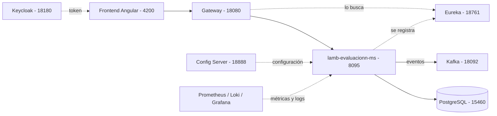

# S1 - Construcción de un servicio base para un sistema distribuido

*Guía principal: agregar un microservicio nuevo (sin CRUD) al proyecto Lamb - Parte 1 de 16 - 2026*

!!! note "Antes de empezar: debe estar levantado"
    Abre **Docker Desktop** (debe decir *Engine running*) y haz la verificación de la [sección 1.5](#15-verifica-tu-computadora-antes-de-todo). En esta sesión todavía no se arranca ningún servicio.

## 0. Liberar todos los puertos (antes de empezar)

Si te sale **`Port 18888 was already in use`** (o cualquier puerto), es porque algo de Lamb ya quedó corriendo:
otra terminal, un `java -jar` o **otra copia del proyecto**. Haz esto antes de crear o arrancar un servicio,
así empiezas limpio.

**Dónde abrir la terminal:** cualquier PowerShell (no importa la carpeta).  
**Qué hace:** apaga todo lo que use los puertos de Lamb. Los programas (`java`, `node`) los cierra, y los
contenedores de Docker (BD, Kafka, Keycloak, Grafana) los detiene **sin** cerrar Docker Desktop.  
**Y pega el siguiente código:**

```powershell
$puertos = @(4200, 8095, 8096, 8097, 13000, 13100, 15436, 18080, 18090, 18092, 18180, 18761, 18888, 19000, 19090) + (8081..8089) + (15451..15461)
foreach ($p in $puertos) {
    $c = Get-NetTCPConnection -LocalPort $p -State Listen -ErrorAction SilentlyContinue | Select-Object -First 1
    if (-not $c) { continue }
    $proc = Get-Process -Id $c.OwningProcess -ErrorAction SilentlyContinue
    if ($proc.ProcessName -match '^(com\.docker\.backend|wslrelay|vpnkit|docker)') {
        docker ps -q --filter "publish=$p" | ForEach-Object { docker stop $_ | Out-Null }
        "[LIBERADO] $p  (contenedor de Docker)"
    } else {
        Stop-Process -Id $c.OwningProcess -Force
        "[LIBERADO] $p  ($($proc.ProcessName))"
    }
}
"Listo: puertos libres."
```

Si un puerto estaba ocupado, sale `[LIBERADO] 18888  (java)`. Si no sale ninguna línea `[LIBERADO]`, ya estaban todos libres.

!!! note "Si tu servicio usa otro puerto"
    Agrega tu puerto a la primera línea (ej. si elegiste `8097` y `15461`, ponlos dentro de `@( ... )`).
    Los contenedores de Docker se vuelven a levantar con su `docker compose ... up -d` de cada sesión.

!!! note "Arranca siempre desde esta carpeta"
    Después de liberar, arranca Config, Eureka, tu servicio y el Gateway desde **esta** copia del proyecto.
    Si tienes otra copia de Lamb en tu PC y la arrancas, su Config Server **no ve** los archivos que creas aquí.

## 1. Introducción

### 1.1 Qué es esta guía

Esta es **la guía principal** del curso, repartida en las sesiones, para agregar **un microservicio nuevo**
al proyecto Lamb (Admisión + Trayectoria) **sin CRUD**: un servicio "Hola mundo" conectado a todo
(Config Server, Eureka, Gateway, Keycloak, PostgreSQL, Kafka, Prometheus, Loki, Grafana) y con una página
Angular simple, **sin diseño**. El código sigue el mismo estilo que el proyecto `pagatu`
(`CorrelationIdFilter`, productor/consumidor Kafka, seguridad con Keycloak).

Todo el código fue ejecutado y probado. El ejemplo es un servicio **`lamb-evaluacionn-ms`**.

**Lo que obtienes al final:** una página "Hola mundo" (con login de Keycloak) y un botón que manda un evento
a Kafka, que ves en Kafka UI y en los logs de Grafana.

### 1.2 ¿Te piden un CRUD?

Si el profe pide **registrar algo** (examenes, pagos, alumnos...) con agregar, editar y eliminar, usa **además** la
[Guía: agregar un servicio con CRUD](../proyecto-sello/servicio-con-crud.md) (en *Guía de Proyecto Sello*).
Esa guía no repite nada: sigues esta guía sesión por sesión y, al terminar cada sesión, haces lo que dice
allá para esa misma sesión.

Para arrancar todo el proyecto con una lista de comandos y ver todos los links (Eureka, Grafana,
Kafka...), usa la [Guía: arrancar la app](../proyecto-sello/arrancar-app.md).

!!! note "Si te sale un error"
    Busca el mensaje en [Solución de errores](Solucion_Errores.md): dice qué archivo abrir y qué cambiar
    (puertos ocupados, base de datos, Gateway, Keycloak, Kafka, Angular...). Todos los links están en
    [Enlaces del sistema](Enlaces_Sistema.md).

!!! note "Si ya sabes y solo quieres copiar"
    En [Resumen rápido](Resumen_Rapido.md) están todos los archivos, con la sesión donde está su versión final.

**Cómo seguir los pasos:** cada paso dice qué archivo **crear**, **modificar** o **reemplazar**, con su ruta completa desde la raíz del proyecto (`Lamb-Modulo02-Admision-Trayectoria`, la carpeta que abres en VS Code). Para crear un archivo: clic derecho en la carpeta → *New File*. Para abrir una terminal en la raíz: *Terminal → New Terminal*.

### 1.3 Mapa de la guía

| Sesión | Qué agregas a tu servicio |
|---|---|
| S1 | Proyecto, código base, Hola mundo, base de datos en Docker |
| S2 | Configuración en el Config Server |
| S3 | Registro en Eureka y varias instancias |
| S4 | Ruta en el Gateway (`http://localhost:18080`) |
| S5 | Evaluación U1: evidencias |
| S6 | (Opcional) Llamar a otro microservicio |
| S7 / S7b | Seguridad: roles en el Gateway con Keycloak |
| S8 | Kafka: enviar y recibir eventos |
| S9 | Consistencia: publicar solo si se guardó |
| S10 | Logs y métricas en Grafana |
| S11 | Frontend Angular sin diseño |
| S12 | Evaluación U2: evidencias |
| S13 | Prueba completa de punta a punta |
| S14 | Problemas comunes y cómo adaptarlo a otro caso |
| S15 / S16 | Demostración y preguntas técnicas |

### 1.4 Dónde queda tu servicio



### 1.5 Verifica tu computadora (antes de todo)

Hazlo **una sola vez** antes de empezar: así evitas errores más adelante.

| Herramienta | Versión | Para qué | Si falta |
|---|---|---|---|
| **Java JDK** | **21** | Compilar y correr los servicios | Instala *Eclipse Temurin 21* (en el instalador activa **Set JAVA_HOME variable**) |
| **JAVA_HOME** | apuntando al JDK 21 | `mvnw` la usa para compilar | Ver "Configurar JAVA_HOME" abajo |
| **Docker Desktop** | con Docker Compose v2+ | BD, Kafka, Keycloak, Grafana... | Instala Docker Desktop (te pedirá activar **WSL 2**: acepta y reinicia) |
| **Node.js** | 20.19+, 22.12+ o 24 (LTS) | Frontend Angular 21 | Instala *Node.js LTS* (trae npm) |
| **npm** | viene con Node.js | Instalar y correr el frontend | — |
| **Git** | cualquiera | Clonar y subir el proyecto | Instala *Git for Windows* |
| **Maven** | no hace falta | `mvnw.cmd` lo descarga solo | — |
| **RAM** | 16 GB recomendado (8 GB mínimo) | Todo corre en tu PC | Con 8 GB levanta solo lo necesario |
| **Internet** | la primera vez | Descargar librerías e imágenes de Docker | — |

**1. Pega esto en PowerShell** (revisa todo de una vez):

**Dónde abrir la terminal:** Cualquier PowerShell (no importa la carpeta). Pega todo el bloque de una vez y pulsa `Enter`.

```powershell
$script:faltan = 0
function Revisar($nombre, [scriptblock]$comando, $esperado, $solucion) {
    try { $salida = (& $comando 2>&1 | Out-String).Trim() } catch { $salida = "" }
    if ($salida -match $esperado) {
        Write-Host ("[OK]    {0,-18} {1}" -f $nombre, (($salida -split "`n")[0].Trim() -replace '^\S+ : ', ''))
    } else {
        Write-Host ("[FALTA] {0,-18} {1}" -f $nombre, $solucion)
        $script:faltan++
    }
}
Revisar "Java 21"          { java -version }  'version "21\.'  "Instala el JDK 21 (Temurin) y vuelve a abrir la terminal"
Revisar "JAVA_HOME (21)"   { & "$env:JAVA_HOME\bin\java.exe" -version } 'version "21\.' "La variable JAVA_HOME debe apuntar a la carpeta del JDK 21"
Revisar "Docker"           { docker --version } 'Docker version' "Instala Docker Desktop"
Revisar "Docker encendido" { docker info --format '{{.ServerVersion}}' } '^\d' "Abre Docker Desktop y espera 'Engine running'"
Revisar "Docker Compose"   { docker compose version } 'version v\d' "Actualiza Docker Desktop"
Revisar "Node.js"          { node -v } '^v(20\.(19|[2-9]\d)|22\.(1[2-9]|[2-9]\d)|2[4-9]|[3-9]\d)\.' "Instala Node.js 22 o 24 (LTS)"
Revisar "npm"              { npm -v } '^\d+\.' "Viene con Node.js: reinstala Node.js"
Revisar "Git"              { git --version } 'git version' "Instala Git para Windows"
Revisar "Permiso scripts"  { Get-ExecutionPolicy } 'RemoteSigned|Unrestricted|Bypass' "Ejecuta: Set-ExecutionPolicy -Scope CurrentUser RemoteSigned"
$ram = [math]::Round((Get-CimInstance Win32_ComputerSystem).TotalPhysicalMemory / 1GB)
if ($ram -ge 16) { Write-Host ("[OK]    {0,-18} {1} GB" -f "Memoria RAM", $ram) }
else { Write-Host ("[AVISO] {0,-18} {1} GB: levanta solo lo necesario (ver Solucion de errores, seccion 11)" -f "Memoria RAM", $ram) }
if ($script:faltan -eq 0) { Write-Host "`nTodo listo." } else { Write-Host "`nFaltan $($script:faltan) cosas: arreglalas antes de seguir." }
```

Debe terminar en **`Todo listo.`** Si alguna línea dice **`[FALTA]`**, haz lo que indica, **cierra y vuelve a abrir
PowerShell** y pégalo otra vez. Así se ve cuando todo está bien:

```text
[OK]    Java 21            openjdk version "21.0.12" 2026-07-21 LTS
[OK]    JAVA_HOME (21)     openjdk version "21.0.12" 2026-07-21 LTS
[OK]    Docker             Docker version 29.7.2, build a7dcaa6
[OK]    Docker encendido   29.7.2
[OK]    Docker Compose     Docker Compose version v5.5.0
[OK]    Node.js            v24.15.0
[OK]    npm                11.12.1
[OK]    Git                git version 2.54.0.windows.1
[OK]    Permiso scripts    RemoteSigned
[OK]    Memoria RAM        16 GB

Todo listo.
```

Tus números pueden ser otros: lo importante es que todo diga `[OK]`.

**Angular** no se instala aparte: viene dentro del proyecto. Compruébalo (la primera vez tarda, descarga librerías):

**Dónde abrir la terminal:** En la **raíz del proyecto** (`Lamb-Modulo02-Admision-Trayectoria`). El bloque entra a `clients\lamb-frontend` y al final vuelve a la raíz.

```powershell
cd clients\lamb-frontend
npm install
npx ng version          # debe decir Angular CLI: 21.x y Node: 20.19+, 22.12+ o 24.x
cd ..\..
```

**2. Revisa que los puertos estén libres:**

```powershell
foreach ($p in 4200, 8095, 13000, 13100, 15436, 15460, 18080, 18090, 18092, 18180, 18761, 18888, 19000, 19090) {
    $c = Get-NetTCPConnection -LocalPort $p -State Listen -ErrorAction SilentlyContinue | Select-Object -First 1
    if ($c) { "[OCUPADO] $p  -> lo usa: $((Get-Process -Id $c.OwningProcess).ProcessName)" } else { "[LIBRE]   $p" }
}
```

Si **ya tienes Lamb levantado**, es normal que salgan ocupados (por `java`, `node`, `wslrelay` o `com.docker.backend`). Si **no** lo tienes levantado y sale `[OCUPADO]`, ciérralo o cambia de puerto: ver [Solución de errores, sección 2](Solucion_Errores.md#2-puertos-ocupados). El `8095` y el `15460` son los de tu servicio nuevo: si están ocupados, elige otros en la sección 2.

!!! note "Configurar JAVA_HOME (si salió [FALTA])"
    1. Busca la carpeta del JDK 21: normalmente `C:\Program Files\Eclipse Adoptium\jdk-21...`
    2. Menú inicio → escribe **variables de entorno** → *Editar las variables de entorno del sistema* → *Variables de entorno*.
    3. En *Variables de usuario* → *Nueva*: nombre `JAVA_HOME`, valor la carpeta del paso 1 (sin `\bin`).
    4. En la misma lista edita `Path` → *Nuevo* → `%JAVA_HOME%\bin` → súbelo arriba de todo.
    5. Acepta, **cierra todas las terminales** (y VS Code) y vuelve a abrirlas.

!!! note "Si algo sigue fallando"
    Busca el mensaje en [Solución de errores](Solucion_Errores.md).

## 2. Elige tus nombres

Toda la guía usa **evaluacionn**. Antes de empezar, decide tus nombres según lo que te pidan
y reemplázalos **en todos los pasos** (en VS Code: `Ctrl+Shift+H`, respetando mayúsculas).

| En la guía dice | Lo cambias por (ej. te piden "Tesorería") | Se usa en |
|---|---|---|
| `evaluacionn` | `tesoreria` | carpeta, paquete Java, rutas, BD, topic Kafka |
| `Evaluacionn` | `Tesoreria` | nombres de clases Java |
| `8095` | un puerto libre | puerto del servicio |
| `15460` | otro puerto libre (15461, 15462...) | puerto de su PostgreSQL |

!!! note "Esto NO se cambia"
    Los puertos de Lamb (`18888` Config, `18761` Eureka, `18080` Gateway, `18092` Kafka, `18180` Keycloak),
    el prefijo `pe.edu.upeu.lamb`, el prefijo de rutas `/api/v1/`, los nombres de las clases de infraestructura
    (`CorrelationIdFilter`, `OpenApiConfig`...) y el
    contenido de los archivos que la guía marca como "copia tal cual".

**Puertos ocupados en Lamb:** 8081–8089, 15451–15459, 18080, 18090, 18092, 18180, 18761, 18888.
Revisa que tu puerto esté libre (si **no imprime nada**, está libre):

```powershell
Get-NetTCPConnection -LocalPort 8095 -State Listen -ErrorAction SilentlyContinue
```

## 3. Crear el proyecto

Aquí **no creas archivos a mano**: un comando crea la carpeta del servicio y sus subcarpetas, y copia
el `pom.xml` y el Maven Wrapper de Trayectoria, que ya traen todas las dependencias
(web, JPA, Flyway, Kafka, seguridad OAuth2, Config, Eureka, Swagger, Actuator, Prometheus, Lombok).
Aunque tu servicio no tenga tablas, se conecta a su propia base de datos (así queda listo si después te piden un CRUD).

**Dónde abrir la terminal:** En la **raíz del proyecto** (`Lamb-Modulo02-Admision-Trayectoria`). En VS Code: *Terminal → New Terminal*. **Comprueba** que estás en la raíz: escribe `ls` y deben salir las carpetas `services`, `infra`, `clients`, `kafka`, `keycloak`, `obs`. Pega todo el bloque de una vez y pulsa `Enter`. Si no sale nada, está bien.

```powershell
$nuevo = "services\lamb-evaluacionn-ms"                              # cambia por tu nombre
$java  = "$nuevo\src\main\java\pe\edu\upeu\lamb\evaluacionn"        # cambia por tu nombre
New-Item -ItemType Directory $nuevo | Out-Null
Copy-Item -Recurse services\lamb-trayectoria-ms\.mvn $nuevo
Copy-Item services\lamb-trayectoria-ms\mvnw, services\lamb-trayectoria-ms\mvnw.cmd, services\lamb-trayectoria-ms\pom.xml, services\lamb-trayectoria-ms\.gitignore $nuevo
(Get-Content "$nuevo\pom.xml") -replace 'lamb-trayectoria-ms','lamb-evaluacionn-ms' -replace '<description>.*</description>','<description>Microservicio de evaluacionn</description>' | Set-Content -Encoding utf8 "$nuevo\pom.xml"
"config","controller","filter" | ForEach-Object { New-Item -ItemType Directory -Force "$java\$_" | Out-Null }
New-Item -ItemType Directory -Force "$nuevo\src\main\resources\db\migration" | Out-Null
```

!!! note "Solo cambian las 2 primeras líneas y `lamb-evaluacionn-ms` / `evaluacionn` del `-replace`"
    El resto del bloque se pega tal cual.

**Resultado:** en VS Code (panel izquierdo, *Explorer*) debe aparecer esto. Las carpetas están **vacías**: los
archivos `.java` los creas tú en los pasos siguientes.

```text
Lamb-Modulo02-Admision-Trayectoria\              <- raíz (la carpeta abierta en VS Code)
└── services\
    └── lamb-evaluacionn-ms\                      <- tu servicio (NUEVO)
        ├── .mvn\                                <- copiado (no lo toques)
        ├── mvnw, mvnw.cmd, pom.xml, .gitignore  <- copiados
        └── src\main\
            ├── java\pe\edu\upeu\lamb\evaluacionn\  <- AQUÍ van los .java
            │   ├── config\
            │   ├── controller\
            │   └── filter\
            └── resources\                       <- AQUÍ van .yml, .xml y .sql
                └── db\migration\
```

**Qué cambiar en este código** (ejemplo: si tu servicio es **Tesorería** y tu CRUD es **Pagos** con `monto` y `fecha`):

- `evaluacionn` (aparece 2 veces) → el nombre de **tu servicio**, en minúscula. Ej.: `tesoreria`.
- Todo lo demás se copia **igual**. Tip: `Ctrl+H` en VS Code, con **Aa** activado (respeta mayúsculas).

!!! note "En VS Code las carpetas salen juntas"
    VS Code muestra `java\pe\edu\upeu\lamb\evaluacionn` en **una sola línea** (`java/pe/edu/upeu/lamb/evaluacionn`).
    Es normal: haz clic derecho sobre esa línea para crear archivos dentro de `evaluacionn`.

## 4. Código base

Todos los archivos Java van dentro de `services\lamb-evaluacionn-ms\src\main\java\pe\edu\upeu\lamb\evaluacionn\`
(o en una de sus subcarpetas: `config\`, `controller\`...). Cada paso te dice cuál.

### 4.1 `LambEvaluacionnMsApplication.java`

**Crea el archivo:** `LambEvaluacionnMsApplication.java`  
**En la ruta:** `services\lamb-evaluacionn-ms\src\main\java\pe\edu\upeu\lamb\evaluacionn\`  
**Cómo:** clic derecho en la carpeta `evaluacionn` → **New File** (es un archivo, no una carpeta) → escribe el nombre exacto.  
**Y pega el siguiente código:**

```java
package pe.edu.upeu.lamb.evaluacionn;

import org.springframework.boot.SpringApplication;
import org.springframework.boot.autoconfigure.SpringBootApplication;

@SpringBootApplication
public class LambEvaluacionnMsApplication {

    public static void main(String[] args) {
        SpringApplication.run(LambEvaluacionnMsApplication.class, args);
    }
}
```

**Qué cambiar en este código** (ejemplo: si tu servicio es **Tesorería** y tu CRUD es **Pagos** con `monto` y `fecha`):

- `evaluacionn` (aparece 1 vez) → el nombre de **tu servicio**, en minúscula. Ej.: `tesoreria`.
- `Evaluacionn` (aparece 2 veces) → el nombre de **tu servicio**, con mayúscula. Ej.: `Tesoreria`.
- Todo lo demás se copia **igual**. Tip: `Ctrl+H` en VS Code, con **Aa** activado (respeta mayúsculas).

!!! note "Más detalle"
    El `package` (tu nombre) y el nombre de la clase (`Lamb` + `TuServicio` + `MsApplication`). Nada más.

### 4.2 `config\SecurityConfig.java` (por ahora todo abierto)

Igual que Admisión y Trayectoria en desarrollo: todo abierto. En la **S7** se cambia por la versión con Keycloak.

**Crea el archivo:** `SecurityConfig.java`  
**En la ruta:** `services\lamb-evaluacionn-ms\src\main\java\pe\edu\upeu\lamb\evaluacionn\config\`  
**Cómo:** clic derecho en la carpeta `config` → **New File** (es un archivo, no una carpeta) → escribe el nombre exacto.  
**Y pega el siguiente código:**

```java
package pe.edu.upeu.lamb.evaluacionn.config;

import org.springframework.context.annotation.Bean;
import org.springframework.context.annotation.Configuration;
import org.springframework.security.config.annotation.web.builders.HttpSecurity;
import org.springframework.security.web.SecurityFilterChain;

@Configuration
public class SecurityConfig {

    // DEV Fase 1: todo abierto. En la S7 se agrega la validacion del token de Keycloak.
    @Bean
    public SecurityFilterChain securityFilterChain(HttpSecurity http) throws Exception {
        http
                .csrf(csrf -> csrf.disable())
                .authorizeHttpRequests(auth -> auth.anyRequest().permitAll());
        return http.build();
    }
}
```

**Qué cambiar en este código** (ejemplo: si tu servicio es **Tesorería** y tu CRUD es **Pagos** con `monto` y `fecha`):

- `evaluacionn` (aparece 1 vez) → el nombre de **tu servicio**, en minúscula. Ej.: `tesoreria`.
- Todo lo demás se copia **igual**. Tip: `Ctrl+H` en VS Code, con **Aa** activado (respeta mayúsculas).

### 4.3 `config\OpenApiConfig.java` (Swagger) - copia tal cual

**Crea el archivo:** `OpenApiConfig.java`  
**En la ruta:** `services\lamb-evaluacionn-ms\src\main\java\pe\edu\upeu\lamb\evaluacionn\config\`  
**Cómo:** clic derecho en la carpeta `config` → **New File** (es un archivo, no una carpeta) → escribe el nombre exacto.  
**Y pega el siguiente código:**

```java
package pe.edu.upeu.lamb.evaluacionn.config;

import io.swagger.v3.oas.models.Components;
import io.swagger.v3.oas.models.OpenAPI;
import io.swagger.v3.oas.models.security.SecurityRequirement;
import io.swagger.v3.oas.models.security.SecurityScheme;
import org.springframework.context.annotation.Bean;
import org.springframework.context.annotation.Configuration;

@Configuration
public class OpenApiConfig {

    private static final String ESQUEMA_JWT = "bearerAuth";

    @Bean
    public OpenAPI openAPI() {
        return new OpenAPI()
                .components(new Components().addSecuritySchemes(ESQUEMA_JWT,
                        new SecurityScheme()
                                .type(SecurityScheme.Type.HTTP)
                                .scheme("bearer")
                                .bearerFormat("JWT")))
                .addSecurityItem(new SecurityRequirement().addList(ESQUEMA_JWT));
    }
}
```

**Qué cambiar en este código** (ejemplo: si tu servicio es **Tesorería** y tu CRUD es **Pagos** con `monto` y `fecha`):

- `evaluacionn` (aparece 1 vez) → el nombre de **tu servicio**, en minúscula. Ej.: `tesoreria`.
- Todo lo demás se copia **igual**. Tip: `Ctrl+H` en VS Code, con **Aa** activado (respeta mayúsculas).

### 4.4 `filter\CorrelationIdFilter.java` (traceId) - copia tal cual

Cada petición lleva un `X-Trace-ID` que sale en los logs. Se usa en la **S10**.

**Crea el archivo:** `CorrelationIdFilter.java`  
**En la ruta:** `services\lamb-evaluacionn-ms\src\main\java\pe\edu\upeu\lamb\evaluacionn\filter\`  
**Cómo:** clic derecho en la carpeta `filter` → **New File** (es un archivo, no una carpeta) → escribe el nombre exacto.  
**Y pega el siguiente código:**

```java
package pe.edu.upeu.lamb.evaluacionn.filter;

import jakarta.servlet.FilterChain;
import jakarta.servlet.ServletException;
import jakarta.servlet.http.HttpServletRequest;
import jakarta.servlet.http.HttpServletResponse;
import org.slf4j.MDC;
import org.springframework.stereotype.Component;
import org.springframework.web.filter.OncePerRequestFilter;

import java.io.IOException;
import java.util.UUID;

@Component
public class CorrelationIdFilter extends OncePerRequestFilter {

    public static final String TRACE_ID_HEADER = "X-Trace-ID";
    public static final String MDC_KEY = "traceId";

    @Override
    protected void doFilterInternal(HttpServletRequest request,
                                     HttpServletResponse response,
                                     FilterChain filterChain) throws ServletException, IOException {
        String traceId = request.getHeader(TRACE_ID_HEADER);
        if (traceId == null || traceId.isBlank()) {
            traceId = UUID.randomUUID().toString();
        }
        try {
            MDC.put(MDC_KEY, traceId);
            response.setHeader(TRACE_ID_HEADER, traceId);
            filterChain.doFilter(request, response);
        } finally {
            MDC.remove(MDC_KEY);
        }
    }
}
```

**Qué cambiar en este código** (ejemplo: si tu servicio es **Tesorería** y tu CRUD es **Pagos** con `monto` y `fecha`):

- `evaluacionn` (aparece 1 vez) → el nombre de **tu servicio**, en minúscula. Ej.: `tesoreria`.
- Todo lo demás se copia **igual**. Tip: `Ctrl+H` en VS Code, con **Aa** activado (respeta mayúsculas).

!!! note "En los archivos que dicen “copia tal cual”"
    Solo cambia la línea `package pe.edu.upeu.lamb.evaluacionn...` por tu nombre.

### 4.5 `src\main\resources\logback-spring.xml` (logs a archivo)

**Crea el archivo:** `logback-spring.xml`  
**En la ruta:** `services\lamb-evaluacionn-ms\src\main\resources\`  
**Cómo:** clic derecho en la carpeta `resources` → **New File** (es un archivo, no una carpeta) → escribe el nombre exacto.  
**Ojo:** Va en `resources`, **no** en la carpeta `java`.  
**Y pega el siguiente código:**

```xml
<?xml version="1.0" encoding="UTF-8"?>
<configuration>
    <include resource="org/springframework/boot/logging/logback/defaults.xml"/>

    <property name="LOG_PATTERN"
              value="%d{yyyy-MM-dd HH:mm:ss.SSS} [%X{traceId}] %-5level %logger{36} - %msg%n"/>

    <appender name="CONSOLE" class="ch.qos.logback.core.ConsoleAppender">
        <encoder>
            <pattern>${LOG_PATTERN}</pattern>
        </encoder>
    </appender>

    <appender name="FILE" class="ch.qos.logback.core.rolling.RollingFileAppender">
        <file>logs/evaluacionn.log</file>
        <encoder>
            <pattern>${LOG_PATTERN}</pattern>
        </encoder>
        <rollingPolicy class="ch.qos.logback.core.rolling.TimeBasedRollingPolicy">
            <fileNamePattern>logs/evaluacionn-%d{yyyy-MM-dd}.log</fileNamePattern>
            <maxHistory>7</maxHistory>
        </rollingPolicy>
    </appender>

    <root level="INFO">
        <appender-ref ref="CONSOLE"/>
        <appender-ref ref="FILE"/>
    </root>
</configuration>
```

**Qué cambiar en este código** (ejemplo: si tu servicio es **Tesorería** y tu CRUD es **Pagos** con `monto` y `fecha`):

- `evaluacionn` (aparece 2 veces) → el nombre de **tu servicio**, en minúscula. Ej.: `tesoreria`.
- Todo lo demás se copia **igual**. Tip: `Ctrl+H` en VS Code, con **Aa** activado (respeta mayúsculas).

!!! note "Más detalle"
    Solo `evaluacionn` en `logs/evaluacionn.log` y `logs/evaluacionn-%d...`. El patrón (`LOG_PATTERN`) no se toca.

## 5. El Hola mundo

Un controlador con `GET /api/v1/evaluacionn/saludo` que responde `Hola mundo desde lamb-evaluacionn-ms`.

**Crea el archivo:** `SaludoController.java`  
**En la ruta:** `services\lamb-evaluacionn-ms\src\main\java\pe\edu\upeu\lamb\evaluacionn\controller\`  
**Cómo:** clic derecho en la carpeta `controller` → **New File** (es un archivo, no una carpeta) → escribe el nombre exacto.  
**Y pega el siguiente código:**

```java
package pe.edu.upeu.lamb.evaluacionn.controller;

import lombok.extern.slf4j.Slf4j;
import org.springframework.beans.factory.annotation.Value;
import org.springframework.web.bind.annotation.GetMapping;
import org.springframework.web.bind.annotation.RequestMapping;
import org.springframework.web.bind.annotation.RestController;

@Slf4j
@RestController
@RequestMapping("/api/v1/evaluacionn")
public class SaludoController {

    @Value("${spring.application.name}")
    private String nombreServicio;

    @GetMapping("/saludo")
    public String saludo() {
        log.info("Saludo solicitado");
        return "Hola mundo desde " + nombreServicio;
    }
}
```

**Qué cambiar en este código** (ejemplo: si tu servicio es **Tesorería** y tu CRUD es **Pagos** con `monto` y `fecha`):

- `evaluacionn` (aparece 2 veces) → el nombre de **tu servicio**, en minúscula. Ej.: `tesoreria`.
- Todo lo demás se copia **igual**. Tip: `Ctrl+H` en VS Code, con **Aa** activado (respeta mayúsculas).

!!! note "Más detalle"
    Solo `evaluacionn` en el `package` y en `@RequestMapping("/api/v1/evaluacionn")`. En la **S8** se le agrega el envío a Kafka.

## 6. Base de datos en Docker

**Crea el archivo:** `compose-dev.yml`  
**En la ruta:** `services\lamb-evaluacionn-ms\`  
**Cómo:** clic derecho en la carpeta `lamb-evaluacionn-ms` → **New File** (es un archivo, no una carpeta) → escribe el nombre exacto.  
**Ojo:** Va **directo** en la carpeta del servicio (al lado del `pom.xml`), no dentro de `src`.  
**Y pega el siguiente código:**

```yaml
name: lamb-evaluacionn-dev

services:
  postgres-evaluacionn-dev:
    image: postgres:16-alpine
    container_name: lamb-postgres-evaluacionn-dev
    restart: unless-stopped
    environment:
      POSTGRES_DB: lamb_evaluacionn_db
      POSTGRES_USER: lamb
      POSTGRES_PASSWORD: lamb
    ports:
      - "15460:5432"
    volumes:
      - lamb_evaluacionn_dev_data:/var/lib/postgresql/data

volumes:
  lamb_evaluacionn_dev_data:
    name: lamb-evaluacionn-data
```

**Qué cambiar en este código** (ejemplo: si tu servicio es **Tesorería** y tu CRUD es **Pagos** con `monto` y `fecha`):

- `evaluacionn` (aparece 7 veces) → el nombre de **tu servicio**, en minúscula. Ej.: `tesoreria`.
- `15460` (aparece 1 vez) → el puerto de la **base de datos** de tu servicio.
- Todo lo demás se copia **igual**. Tip: `Ctrl+H` en VS Code, con **Aa** activado (respeta mayúsculas).

!!! note "Más detalle"
    `evaluacionn` en todos los nombres y el puerto `15460`. No cambies `5432` (puerto interno) ni la imagen.

!!! note "El `name:` del volumen es obligatorio"
    Si dos proyectos usan el mismo nombre de volumen, **comparten la base de datos** y Flyway falla.

Levántala:

**Dónde abrir la terminal:** En la **raíz del proyecto** (`Lamb-Modulo02-Admision-Trayectoria`). En VS Code: *Terminal → New Terminal*. Docker Desktop debe estar abierto. Al final, `docker ps` debe mostrar `lamb-postgres-evaluacionn-dev`.

```powershell
docker compose -f services/lamb-evaluacionn-ms/compose-dev.yml up -d
```

!!! note "Archivos de esta sesión"
    Creas:

    - `services\lamb-evaluacionn-ms\pom.xml`, `mvnw`, `mvnw.cmd`, `.mvn`, `.gitignore` (copiados de Trayectoria)
    - `services\lamb-evaluacionn-ms\src\main\java\pe\edu\upeu\lamb\evaluacionn\LambEvaluacionnMsApplication.java`
    - `services\lamb-evaluacionn-ms\src\main\java\pe\edu\upeu\lamb\evaluacionn\config\SecurityConfig.java` - temporal, **se reemplaza en la S7**
    - `services\lamb-evaluacionn-ms\src\main\java\pe\edu\upeu\lamb\evaluacionn\config\OpenApiConfig.java`
    - `services\lamb-evaluacionn-ms\src\main\java\pe\edu\upeu\lamb\evaluacionn\filter\CorrelationIdFilter.java`
    - `services\lamb-evaluacionn-ms\src\main\resources\logback-spring.xml`
    - `services\lamb-evaluacionn-ms\src\main\java\pe\edu\upeu\lamb\evaluacionn\controller\SaludoController.java` - **se reemplaza en la S8**
    - `services\lamb-evaluacionn-ms\compose-dev.yml`

## 7. Evidencia de cierre de la S1

El servicio todavía **no arranca** (le falta su configuración, que se agrega en la S2), pero ya debe **compilar**:

**Dónde abrir la terminal:** En la **raíz del proyecto** (`Lamb-Modulo02-Admision-Trayectoria`). En VS Code: *Terminal → New Terminal*. El bloque entra a la carpeta de tu servicio. La primera vez tarda (descarga librerías).

```powershell
cd services\lamb-evaluacionn-ms
.\mvnw.cmd -DskipTests package
```

Debe terminar en `BUILD SUCCESS`.

**Si te piden CRUD:** ahora haz la [parte S1 de la guía con CRUD](../proyecto-sello/servicio-con-crud.md#2-s1-tabla-entidad-dto-mapper-servicio-y-controlador).

Siguiente: [S2 - Configuración centralizada](S02_Configuracion_Centralizada_Ambientes.md).
